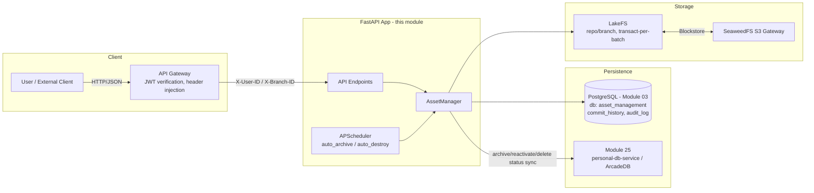

# Asset Management Service (Module 04)

---

## Overview

**Module 04** is Raptor 0.5's asset storage service: it handles upload, versioning, lifecycle (uploaded → processing → active/failed, archive, destroy), and associated-file management for every asset in the platform. It's a FastAPI app backed by **LakeFS** (versioned object storage) + **SeaweedFS** (the S3-compatible blockstore LakeFS writes to) for content, and a shared **PostgreSQL** instance (Module 03, database `asset_management`) for metadata.

Upload and AI analysis are decoupled: `POST /fileupload` only commits the file (`status=uploaded`); analysis is triggered separately via Module 13's Register API, and the actual claim + status write-back is done by the processing workers (Modules 09-12). See [API.md](./docs/API.md) §1.3 for the full status lifecycle.

Authentication is **not** done in this service — it trusts `X-User-ID`/`X-Branch-ID` headers, which the API Gateway is expected to inject after its own JWT/Keycloak verification (see `get_user()` in `asset_management/endpoints.py`).

---

## 📦 Features

* **Multi-Format Asset Storage**: Upload images, videos, documents, audio, and other files with automatic MIME type detection.
* **Versioning**: Every write is a LakeFS commit; associated-file batches are grouped into a bounded number of transactions internally (`batch_upload()`) rather than one commit per file, with no caller-facing size limit.
* **Content Dedup**: Identical content re-uses an existing active asset (Knowledge Hit) or clones an archived one's index (Clone Point) instead of re-uploading/re-analyzing.
* **Lifecycle Management**: `archive`/`destroy` with relative-TTL (`30d`, `1y`, ...) or absolute-date expiration policies, enforced automatically by an APScheduler-driven daily job (`auto_archive`/`auto_destroy`).
* **RESTful API**: See [API.md](./docs/API.md) for the full endpoint reference.
* **SeaweedFS Cluster**: 3-master, 4-volume, 2-rack SeaweedFS deployment behind LakeFS, with `011` replication and continuous filer-metadata backup to `./backup`.

---

## System Architecture Overview



---

## 📁 Project Structure

```
.
├── asset_management/           # Core application code
│   ├── client.py               # High-level asset operations (AssetManager)
│   ├── config.py               # Configuration via Pydantic Settings
│   ├── database.py             # Async PostgreSQL interactions
│   ├── endpoints.py            # FastAPI routes and scheduler
│   ├── __init__.py
│   ├── models.py               # Data models
│   ├── object_store.py         # LakeFS/SeaweedFS logic (transact-based commits)
│   ├── utils.py                # Utility functions
│   └── search_sync.py          # Module 25 (personal-db-service) status sync
│                                # (Qdrant/OpenSearch clients retired, Module 17/20)
│
├── docker-compose.yml          # This module's own services (app, LakeFS, SeaweedFS)
├── Dockerfile                  # Application container definition
├── requirements.txt            # Python dependencies
├── README.md                   # This file
├── docs/
│   ├── API.md                  # Full API reference
│   └── TEST.md                 # How to run tests/unit/ and tests/integration/
├── .env.example                # Environment variable template
├── ensure_nfs_dirs.sh          # Script to create NFS directories from .env
│
├── tests/
│   ├── unit/                   # Pure logic, hand-written fakes, no live infra
│   └── integration/            # Hits a real running Module 04 + LakeFS + Postgres + SeaweedFS
│
└── docker_compose_settings/    # External service configurations
    ├── seaweedfs/               # master.toml, filer_generated.toml, filer-entrypoint.sh, replication.toml
    └── lakefs/gc-runner          # Dockerfile, entrypoint.sh, run-gc.sh
```

---

## ⚙️ Prerequisites

* [**Docker and Docker Compose**](https://docs.docker.com/compose/) : For running the services.
* **Python 3.10+** : For local development (if not using Docker).
* **A running Postgres (Module 03) and the unified platform `.env`** — this module doesn't run its own Postgres; see the repo root's `deploy.sh`/`build.py` for platform-wide orchestration.
* **Environment Variables** : Create a `.env` file with the required configurations (see Configuration).

---

## 🛠️ Setup and Installation

Module 04 is normally started as part of the platform via the repo root's `deploy.sh`/`build.py` (e.g. `bash deploy.sh -m 04`), which passes in the unified `deployment/modules/.env`. To run it standalone instead:

1. **Configure Environment Variables**:

```bash
cp .env.example .env
```

* Edit the `.env` file with your desired configuration.
  * **Ensure the `S3_PUBLIC_URL` is set correctly** (usually `http://your-ip-address:8333` for local development).
  * **`NFS_EXPORT`/`BASE_DIR` must be either a new directory or an existing directory that can be safely cleared before initializing storage**.

2. **Build and Run with Docker Compose**:

```bash
# Create new NFS directories (will remove existing directories)
sudo bash ensure_nfs_dirs.sh
docker compose up --build -d
```

3. **Verify the Services**:

```bash
docker compose ps
docker compose logs -f
```

---

## ⚙️ NFS Mount Configuration for Docker Services

To properly mount NFS-shared directories in Docker Compose, the workflow is divided into three parts:

### 1. Define Required Directories (`.env`)

All directories to be mounted are defined in .env:

```yaml
# NFS settings (SeaweedFS will be mounted at ${NFS_SERVER}:${NFS_EXPORT}/${BASE_DIR})
NFS_SERVER=<NFS_SERVER_IP>
NFS_EXPORT=/raptor
BASE_DIR=seaweedfsTest
SUB_DIRS="admin s3 backup filer vol1 vol2 vol3 vol4 master1 master2 master3"
TMP_MNT=/opt/raptor
```

This ensures all required mount points are declared in a single place.

---

### 2. Automatically Ensure Directories Exist (`ensure_nfs_dirs.sh`)

A helper script reads `.env` and creates the corresponding directories on the NFS server.
The script automatically loads values from `.env`, mounts the NFS export temporarily, and ensures the directory structure exists:
Usage:

```bash
sudo bash ensure_nfs_dirs.sh
```

---

### 3. Configure NFS Volumes in `docker-compose.yml`

Volumes in `docker-compose.yml` reference environment variables defined in `.env`.
Example configuration for SeaweedFS master nodes:

```yaml
volumes:
  seaweedfs_master1:
    driver: local
    driver_opts:
      type: "nfs"
      o: "addr=${NFS_SERVER},nfsvers=4"
      device: ":${NFS_EXPORT}/${BASE_DIR}/master1"

  seaweedfs_master2:
    driver: local
    driver_opts:
      type: "nfs"
      o: "addr=${NFS_SERVER},nfsvers=4"
      device: ":${NFS_EXPORT}/${BASE_DIR}/master2"

  seaweedfs_master3:
    driver: local
    driver_opts:
      type: "nfs"
      o: "addr=${NFS_SERVER},nfsvers=4"
      device: ":${NFS_EXPORT}/${BASE_DIR}/master3"
```

Other directories (volumes, filer, s3, admin, backup) are configured in the same way, using the same `${NFS_SERVER}`, `${NFS_EXPORT}` and `${BASE_DIR}` environment variables.

---

### 📌 Notes

* The `.env` file contains all necessary configuration values:
  * NFS server address
  * NFS export path
  * Temporary mount path
* Docker Compose volumes reference `.env` variables to avoid hardcoding NFS paths.
* `ensure_nfs_dirs.sh` prepares the NFS bind-mount directories used by certain containers (i.e., SeaweedFS) **before** the containers start.
  Since `docker compose down -v` does **not** remove old data on NFS-mounted paths, if you want to **shut down the old services and start clean ones**, you must run the script **after** `docker compose down -v` and **before** `docker compose up -d`.
  This ensures all directories are freshly created and avoids conflicts between old and new data:

  ```bash
  docker compose down -v
  sudo bash ensure_nfs_dirs.sh
  docker compose up -d
  ```

---

## 🔧 Configuration

The application uses environment variables defined in the `.env` file, managed by the `Settings` class in `config.py`.

<details>
<summary>Configuration Variables (click to expand)</summary>

| Variable                                                                   | Description                                                                                                                                                                   |
| :------------------------------------------------------------------------- | :---------------------------------------------------------------------------------------------------------------------------------------------------------------------------- |
| `S3_ENDPOINT`                                                              | **Internal Endpoint**: The URL for the application (`app` service) to connect to the SeaweedFS S3 gateway **within the Docker network**. Example: `http://seaweedfs-s3:8333`. |
| `S3_PUBLIC_URL`                                                            | **External Download URL**: Base URL for generating **public presigned download links**, reachable by external clients. Example: `http://<YOUR_IP>:8333`.                |
| `S3_BUCKET`                                                                | The S3 bucket name where all assets are stored, e.g., `lakefs`.                                                                                         |
| `AWS_ACCESS_KEY` / `AWS_SECRET_KEY`                                        | Access key and secret key for authenticating with the S3-compatible SeaweedFS service.                                                                                        |
| `VOLUME_SIZE_LIMIT_MB`                                                     | Maximum storage capacity (in MB) for each SeaweedFS volume. Example: 512                                                                          |
| `MAX_NUMBER_OF_VOLUMES`                                                    | Maximum number of volumes allowed per SeaweedFS volume server. Example: 100.                                                                                                  |
| `POSTGRES_HOST` / `POSTGRES_PORT`                                                | Hostname and port for the shared PostgreSQL service (Module 03). Within Docker network, host is typically `postgres`.                                                                           |
| `POSTGRES_USER` / `POSTGRES_PASSWORD` / `POSTGRES_DB` | PostgreSQL application user, user password, and database name (`asset_management`) used by this module.                                                                              |
| `TIMEZONE`                                        | Used to unify time definition across services. Example: Asia/Taipei                                                           |
| `LAKEFS_ENDPOINT`                                                          | Internal endpoint for the application to connect to lakeFS within Docker network.                                                                                             |
| `LAKEFS_ACCESS_KEY` / `LAKEFS_SECRET_KEY`                                  | Credentials for the application to authenticate with lakeFS.                                                                                                                  |
| `LAKEFS_AUTH_ENCRYPT_SECRET_KEY`                                           | Encryption key used by lakeFS for authentication-related operations.                                                                                                          |
| `LAKEFS_REPOSITORY`                                                        | Name of the repository in lakeFS used by the application. Example: `asset-management`.                                                                                        |
| `LAKEFS_PRE_SIGNED_EXPIRY`                                                 | Default expiry duration for lakeFS presigned URLs. Example: `20m` for 20 minutes.                                                                                             |
| `LAKEFS_TX_MAX_RETRIES`                                                    | Retries for a batch-commit transaction that loses a rare same-path merge race. Default: `3`.                                                                                  |
| `LAKEFS_BATCH_GROUP_MAX_FILES` / `LAKEFS_BATCH_GROUP_MAX_BYTES`            | Not caller-facing limits -- control when `batch_upload()` splits internally into more than one LakeFS transaction. Defaults: `500` files / `200MB`.                          |
| `REDIS_HOST` / `REDIS_PORT`                                                | Redis instance used to cache presigned download URLs.                                                                                                                          |
| `PRESIGN_URL_CACHE_ENABLED`                                                | Set to `false` to disable presigned-URL caching (always generates a fresh one).                                                                                              |
| `PERSONAL_DB_SERVICE_URL`                                                  | Module 25 (personal-db-service) endpoint for status sync on archive/reactivate/delete. Empty string disables the call.                                                        |
| `NFS_SERVER`                                                               | Hostname or IP of the NFS server for mounting shared directories.                                                                                                             |
| `NFS_EXPORT`                                                               | Exported path on the NFS server. Example: `/raptor`.                                                                                                                          |
| `BASE_DIR`                                                                 | Base directory under the NFS export where application data will be stored. Example: `seaweedfs`.                                                                              |
| `SUB_DIRS`                                                                 | Space-separated list of subdirectories to create under `BASE_DIR`. Example: `"admin s3 backup filer vol1 vol2 vol3 vol4 master1 master2 master3"`.                            |
| `TMP_MNT`                                                                  | Local temporary mount path for NFS during initialization. Example: `/opt/raptor`.                                                                                             |
| `AUTO_DAILY_ARCHIVE_TIME`                                                  | Time of day to automatically archive assets daily. Format: `HH:MM`. Example: `00:00`. |
| `AUTO_DAILY_DESTROY_TIME`                                                  | Time of day to automatically destroy assets daily. Format: `HH:MM`. Example: `01:00`. |

`QDRANT_HOST`/`QDRANT_PORT`/`OPENSEARCH_*`/`GRAPH_SERVICE_URL` are still read by `config.py` for backward compatibility, but nothing calls them -- Module 17/20 (the old Qdrant/OpenSearch/Neo4j search stack) were retired and replaced by Module 25 (`personal_db_service_url` above).

</details>

---

## 🌐 Service Access

Once all services are running, you can access the following endpoints:

| Service                      | URL                                                   | Port  |
| :--------------------------- | :---------------------------------------------------- | :---- |
| **FastAPI Swagger UI** | [http://localhost:8000/docs](http://localhost:8000/docs) | 8000  |
| **lakeFS UI** | [http://localhost:8001](http://localhost:8001) | 8001  |
| **SeaweedFS Admin UI** | [http://localhost:23646](http://localhost:23646)         | 23646 |

<details>
<summary>🔌 Port usage (click to expand)</summary>

| Service                                 | Container Port | Host Port (`.env` var)        | Description                   |
| ---------------------------------------- | --------------- | ------------------------------ | ------------------------------ |
| **app**                                 | 8000             | `PORT_ASSET_MANAGEMENT` (8000) | FastAPI application server    |
| **lakeFS**                              | 8000             | `PORT_LAKEFS` (8001)           | lakeFS UI + API                     |
| **seaweedfs-s3**                        | 8333             | `PORT_SEAWEEDFS_S3` (8333)     | S3-compatible API             |
| **seaweedfs-admin**                     | 23646            | `PORT_SEAWEEDFS_ADMIN` (23646) | SeaweedFS Admin Web UI        |

> ⚠️ **Reminder**: If your environment uses a firewall (e.g., UFW, iptables, or cloud security groups), make sure to **open the host ports listed above** to allow external access to the corresponding services.

</details>

---

## 📘 API Endpoints

All API endpoint definitions, request/response formats, and examples are documented in **[API.md](./docs/API.md)**.

---

## 📝 Notes

* **SeaweedFS Clustering**: The SeaweedFS setup uses 3 master servers for high availability (consensus mode) and 4 volume servers distributed across 2 racks for redundancy. Replication is configured as `011` (replicate once on the same rack, once on a different rack in the same data center).
* **Backup**: The `seaweedfs-backup` service continuously replicates filer data to the `./backup` directory. Ensure this directory is persisted and regularly backed up to prevent data loss.
* **Networking**: All services in this module communicate over the shared `raptor` Docker bridge network (name overridable via `DOCKER_NETWORK`), the same network the rest of the Raptor 0.5 platform's modules join.
* **Testing**: See **[TEST.md](./docs/TEST.md)** for how to run `tests/unit/` (no live infra) and `tests/integration/` (needs this module + LakeFS + Postgres + SeaweedFS running).
